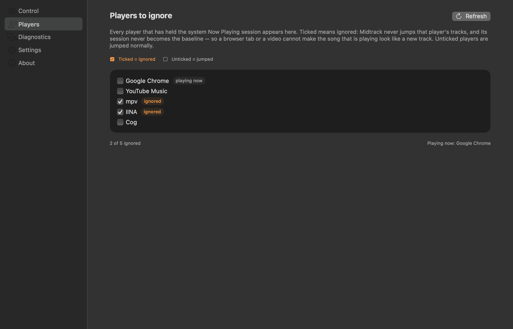

# Midtrack

[](https://github.com/xaepudin/midtrack-macos/actions/workflows/ci.yml)
[](https://github.com/xaepudin/midtrack-macos/releases/latest)
[](LICENSE)

**Skip to the good part — automatically.**

Midtrack is a small macOS menu bar app for radio-style listening. It watches the
system Now Playing session — YouTube Music in a browser, Spotify, Apple Music,
Cog, mpv, or anything else that publishes to Now Playing — and jumps each new
track to the spot you choose.

A quick menu bar panel and a full window for everything else:

<p>
  
  
</p>

## Install

Midtrack requires **macOS 15 or later**.

1. Download the latest `.dmg` from
   [Releases](https://github.com/xaepudin/midtrack-macos/releases/latest).
2. Open the disk image and drag **Midtrack** into **Applications**.
3. Launch it. The first launch shows a short welcome sheet; afterwards Midtrack
   lives in the menu bar and opens its main window at launch.

The release is ad-hoc signed, not notarized — Midtrack uses a private macOS API
and is not distributed through the App Store. If macOS blocks the first launch,
right-click the app and choose **Open**, or run:

```bash
xattr -dr com.apple.quarantine /Applications/Midtrack.app
```

To start Midtrack automatically, add it in **System Settings › General › Login
Items** (choose `Applications/Midtrack.app`, not the source launcher).

## First launch

The menu bar shows the Midtrack waveform mark. The first track it sees is only a
**baseline** and is never jumped. From the next track on, every new track gets
its jump.

Closing the main window removes Midtrack from the Dock and ⌘-Tab but keeps it
watching in the menu bar. Use **Quit Midtrack** in the menu bar panel to exit.

## Using Midtrack

### The menu bar panel

Click the waveform icon. The panel shows:

- **Status and pause** — the master switch. Pausing still tracks track changes,
  so starting again mid-song never yanks the track that is playing.
- **Now playing** — title, artist, player, position, and the next jump target.
- **Jump now** — applies the rule to the song already playing. It is disabled
  while paused or when nothing is playing.
- **Jump target** — Time, Percent, or Random.
- **Random window** — one two-handle slider. Drag either handle; the handles may
  cross, and the window is always the range between them.
- **Also seek on natural end** — off means only tracks you skipped to are
  jumped; tracks that ended by themselves are left alone.
- **Players to ignore** — always visible. Ticked players are excluded; see below.
- **Open Midtrack** and **Quit Midtrack**.

Guardrails and Settings live in the main window, not the panel.

### The main window

| Tab | What it is for |
| --- | --- |
| **Control** | Status, now playing, jump target, guardrails, and the active rule |
| **Players** | Every player seen holding Now Playing, with its ignore tick |
| **Diagnostics** | Live status, the log, a copyable report, and the `--check` command |
| **Settings** | Window behaviour, the welcome sheet, log access, version |
| **About** | Version, repository, issue tracker, and licence |

The Control tab is the same surface as the menu bar panel, with Guardrails added.

### Choosing where to jump

- **Time** — a fixed offset, e.g. always jump to 1:30.
- **Percent** — a fraction of every track, e.g. always jump to 20%.
- **Random** — a fresh spot inside a window for every track. Drag either end of
  the two-handle slider; the handles may cross and the window is always read as
  the ordered range between them.

**Guardrails** are off by default and live in the main window. Turn on
**Enable guardrails** to apply:

- **Min length** — skip short items such as ads, jingles, or 26-second videos.
- **Max jump** — never land past a percentage of the track, so a long jump
  cannot drop you into the outro.

While guardrails are off, both sliders are locked and ignored. A track with no
known length — a live stream, an ad, or a video with no duration — is never
jumped either way.

## Players to ignore

This list is a **deny-list**, not an allow-list. Ticking a player excludes it:

- **Ticked = ignored.** Midtrack never jumps a track published by that player,
  and that player's session never becomes the baseline. **Jump now** refuses an
  ignored player too.
- **Unticked = jumped normally.** The player can own the Now Playing session,
  become the baseline, and have its new tracks jumped.
- The player currently holding the session is marked **playing now**.
- A player only appears after it has published a session at least once. Use
  **Refresh** on the Players tab to re-read the list.
- A session with no player name cannot be matched, so it is never ignored.



## Good to know

- **The first track is a baseline.** Midtrack never jumps the song that was
  already playing when it started or when you enabled it.
- **The same track is not jumped twice within 30 seconds.** Replaying a song
  later still gets its jump.
- **Two players can share the session.** When a browser tab takes Now Playing
  and gives it back, the ignore list and the position guard keep the song from
  being jumped a second time.
- **Chrome can freeze its media updates** while a tab is heavily backgrounded.
  Midtrack keeps the last known state and catches up when Chrome resumes.
- **Midtrack does not capture audio.** It reads now-playing metadata and writes
  a playback position; it does not record, play, or analyse sound.

## Troubleshooting

- **The menu bar icon is missing.** Menu bar managers such as Ice or Bartender
  may file new items under *Hidden*. Drag the Midtrack mark into *Visible* in
  their layout editor.
- **Nothing is playing / no jump.** Start playback in any player, then check the
  panel's status line. The Diagnostics tab shows the reader state.
- **It says “guardrails off”.** That is the default. Turn guardrails on in the
  main window's Control tab if you want the limits.
- **The song is shorter than the minimum.** With guardrails on, short clips are
  skipped deliberately.
- **The app is blocked by macOS.** See the Gatekeeper step under Install.
- **Something else.** Open **Diagnostics › Copy Report** and attach it to an
  issue at <https://github.com/xaepudin/midtrack-macos/issues>. The log lives at
  `~/Library/Logs/Midtrack/app.log`.

More detail: [docs/diagnostics.md](docs/diagnostics.md).

## Privacy

Midtrack has no account, no network code, and no telemetry. It reads the system
Now Playing session through `osascript` and writes the new position through
Apple's private `MediaRemote` API. Audio never leaves the Mac. Settings and logs
stay on the machine.

## Uninstall

1. Quit Midtrack from the menu bar panel.
2. Delete `Applications/Midtrack.app`.
3. Optionally remove `~/Library/Preferences/com.xaepudin.midtrack.plist` and
   `~/Library/Logs/Midtrack/`.

## License

Midtrack is free software, licensed under **GPL-3.0-only**. See [LICENSE](LICENSE).

Copyright © 2026 Asep Saepudin.

The app is an independent project. It uses the private `MediaRemote` framework
and is not affiliated with Apple, Google, YouTube, Spotify, or any player vendor.

## Development

The end-user README stays here; build instructions, architecture, diagnostics,
and release notes live in [docs/](docs/README.md).

- [Building and testing](docs/building.md)
- [Architecture and watcher rules](docs/architecture.md)
- [Diagnostics](docs/diagnostics.md)
- [Release pipeline](docs/release.md)
- [Changelog](CHANGELOG.md)

Repository: <https://github.com/xaepudin/midtrack-macos>
