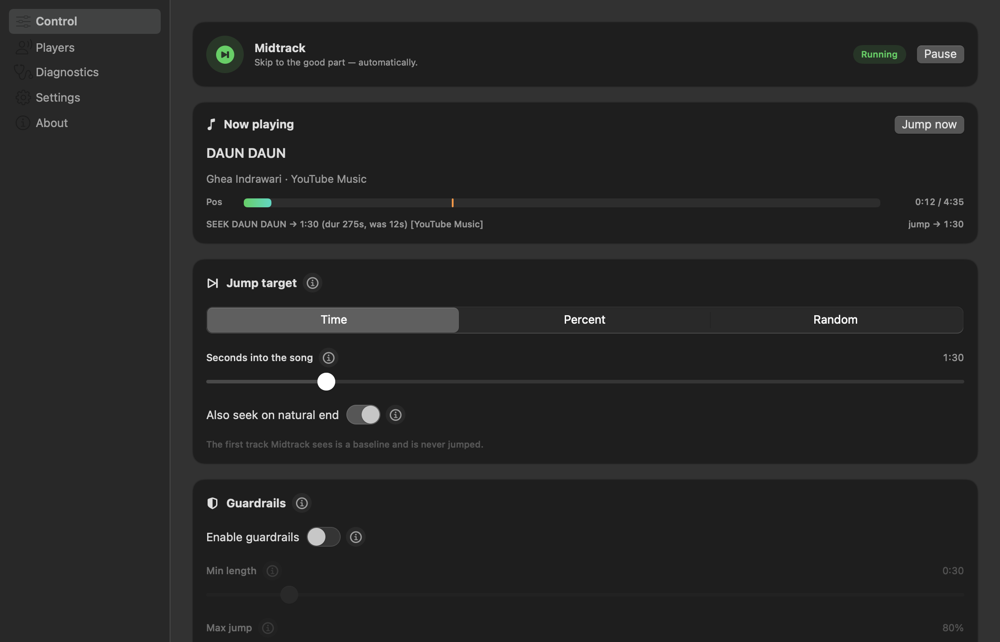
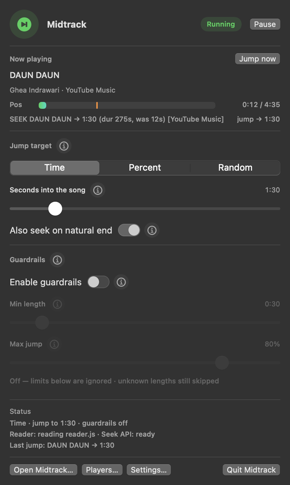
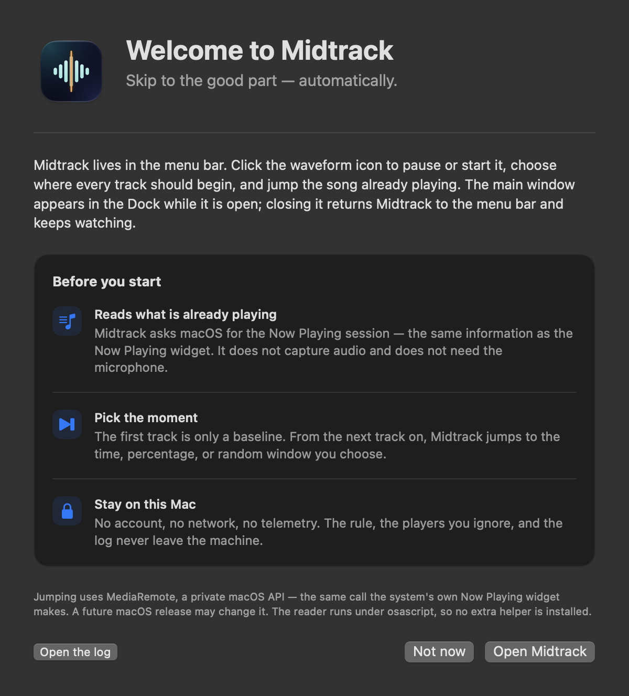

# Midtrack — macOS

**Skip to the good part — automatically.**

Midtrack watches the system Now Playing session on macOS — YouTube Music in a
browser, Spotify, Apple Music, Cog, mpv, anything that publishes to Now Playing —
and jumps each new track to the spot you choose: a fixed time, a percentage of
the song, or a random point inside a window.

It shares its shape with its sibling
[Konvolusi](https://github.com/xaepudin/konvolusi): a conventional window with a
sidebar, a compact menu bar panel that shares the same controls, a welcome sheet,
diagnostics, and an app icon that says what the thing does.

<p>
  
  
</p>

<p>
  
</p>

## Quick start

macOS 15 or later, with the Xcode command line tools (Swift 6 tooling).

```bash
./build.sh                     # builds dist/Midtrack.app
open dist/Midtrack.app         # menu bar icon + main window
```

`./Midtrack` is a stable launcher for a Login Item. The first launch explains the
menu bar icon and the private seek API; after that the main window opens at
launch and the menu bar icon stays put. Closing the window removes Midtrack from
the Dock and ⌘-Tab but leaves it watching in the menu bar. Quit it from the menu
bar panel.

The **first track is only a baseline** — Midtrack never yanks the song that was
already playing when it started. From the next track on, every new track gets its
jump.

## The window

| Sidebar | What lives there |
| --- | --- |
| **Control** | Status, now playing, jump target, guardrails, and rules in force |
| **Players** | Every player seen holding the Now Playing session, with an ignore tick for each |
| **Diagnostics** | Live status lines, the log, and the `--check` command |
| **Settings** | What closing the window means, the welcome sheet, log access, version |
| **About** | The icon, version, and what Midtrack is (and is not) |

The Control tab is deliberately the same surface as the menu bar panel, just
roomier. The panel drops the player list to keep the menu bar window short; its
**Players…** button opens the full tab.

### Controls

| Control | What it does |
| --- | --- |
| **Running / Paused** + **Pause / Start** | Master switch. Paused still tracks track changes, so starting again mid-song never yanks the track that is playing |
| **Jump now** | Applies the rule to the song **already playing** — the Android app's third notification button. It ignores the dedup and the min-length limit (an explicit “do it anyway”), but still refuses a track with no known length. Greyed out, with the reason, while paused or when nothing is playing |
| **Time / Percent / Random** | How the jump target is chosen |
| **Seconds / Percent into the song** | A fixed offset, or the fraction of every track |
| **From / To** | The window Random picks from |
| **Also seek on natural end** | Off = only seek tracks you skipped to; tracks that ended by themselves are left alone |
| **Enable guardrails** | Off by default. While off, Min length and Max jump are ignored and their sliders are locked; turning it on applies the values below |
| **Min length** | Nothing shorter than this is jumped — an ad, a jingle, a 26-second X/Threads video. It keys on the *track's length*, not on which app is playing. Default 1:30. 0 turns this limit off |
| **Max jump** | Never jump past this percent, so a long jump cannot land in the outro. Default 80%. 0 turns this limit off |
| **Pos** meter | Green = how far in, orange tick = where the next jump lands (a shaded band in Random mode) |
| **Status** line | The watcher's narration: baseline, track change, `SEEK … → 1:41`, or *why* it skipped |
| **Players** | Ticked players are ignored entirely: never jumped, and never allowed to become the baseline |

Settings persist in `~/Library/Preferences/com.asep.midtrack.plist`.

## How it works

```
reader.js ──▶ osascript child ──▶ snapshots ──▶ Watcher ──▶ MRMediaRemoteSetElapsedTime
 (JXA)          (Apple-signed)       10 Hz        rules                (private API)
```

- **Read:** a persistent `osascript` child runs `reader.js` (JXA). On macOS 26
  the MediaRemote *read* is gated to Apple-signed processes — a normal binary
  gets nil, but osascript works. The child prints a line on every MediaRemote
  change notification plus a 0.1 s fallback poll, so seek latency is the player's
  own publication time, not our poll interval.
- **Seek:** `MRMediaRemoteSetElapsedTime()` via `dlopen` — the same private
  function the system Now Playing widget uses.
- Same rules as the Android app: baseline the track playing at startup, wait for
  a length before jumping, never land on the very end, per-track dedup,
  auto-next option, and optional min-length / max-jump limits.

The UI is split so the 10 Hz values cannot invalidate the menu bar scene: they
live in `NowPlayingStore`, and are only mirrored while the panel or the main
window is on screen. The `MenuBarExtra` label observes only `StatusStore`.

## Why a song used to get jumped twice

Two players can hold the Now Playing session, and on macOS they hand it back and
forth: YouTube Music plays, a browser tab starts a video, the session moves to
Chrome, the video ends and the session returns to the music. Every hand-back made
the song look like a **brand new track**, and the dedup only remembered the single
most recent jump — which the intervening video had overwritten:

```
[09:09:38] SEEK Sinikini - Dan Senyumlah (VC) → 0:57 (dur 286s, was 119s) [YouTube Music]
```

Midtrack's watcher handles that with three rules:

1. **The ignore list** (the structural fix). A session from a ticked player is
   ignored outright and never becomes the baseline, so when the song's session
   comes back its key is unchanged and no track change — and no jump — is even
   considered. Tick `Google Chrome` in **Players** and the X/Threads tabs stop
   existing here.
2. **A position is only evidence if it belongs to the new track.** The watcher
   compares the position with the one from before the change — a number that has
   not moved is the previous track's and cannot veto the jump. This is what
   refuses the 62-second pull-back above even with no ignore list set.
3. **A same-title re-post right after the baseline is absorbed** — Android's 3 s
   window. The reader's first line for a track can arrive before the artist (or a
   corrected length) does, and the next line looked like a brand-new track: a jump
   a fifth of a second after launch.

**Turn on guardrails** if you want Midtrack to refuse short items in the first
place — saying so in the status line instead of jumping into a 26-second video.

What is deliberately *not* here is a memory of every track ever jumped to. The
only dedup is the original per-track one — the same track is not jumped twice
within 30 seconds — so replaying a song later still gets its jump.

All three shapes are covered by tests: the ignored player
(`testAnIgnoredPlayerNeverDisturbsTheBaseline`), the song that was jumped before
(`testAVideoStealingTheSessionDoesNotJumpTheSongAgain`) and the one that was the
baseline and is now mid-track
(`testAReturningBaselineSongIsNotYankedBackwards`).

## Command line

```bash
swift test --disable-sandbox                            # run the 48 tests
dist/Midtrack.app/Contents/MacOS/Midtrack --check       # self-check, then exit
dist/Midtrack.app/Contents/MacOS/Midtrack --render-window window.png
dist/Midtrack.app/Contents/MacOS/Midtrack --render-window players.png --tab players
dist/Midtrack.app/Contents/MacOS/Midtrack --render-panel panel.png
dist/Midtrack.app/Contents/MacOS/Midtrack --render-panel squeezed.png --height 600
dist/Midtrack.app/Contents/MacOS/Midtrack --render-onboarding welcome.png
dist/Midtrack.app/Contents/MacOS/Midtrack --render-menubar-icon glyph.png
```

`--check` reports the bundle, the reader script it resolved, whether the private
seek symbol is available, the rule and guardrails in force, and one live
now-playing snapshot:

```
Midtrack self-check
  bundle          : com.asep.midtrack (…/dist/Midtrack.app)
  reader script   : …/Contents/Resources/reader.js (found)
  MediaRemote seek: available
  settings        : on · Time · jump to 1:30 · guardrails off · auto-next on
  ignoring        : nobody
  seen players    : YouTube Music, Google Chrome, mpv, IINA, Cog
  log             : /Users/asep/Library/Logs/Midtrack/app.log
  now playing     : YouTube Music · DAUN DAUN — Ghea Indrawari (4:35 / 4:35, rate 0.0)
RESULT: PASS — the seek API is reachable and reader.js is producing snapshots.
```

The render modes photograph the real SwiftUI surfaces off-screen with AppKit
controls, so a layout change can be reviewed without hunting for the status item.
`--appearance dark|light` pins the appearance for documentation; `--tab` picks a
sidebar tab. `--height` squeezes the panel into a shorter window on purpose: a
`MenuBarExtra` window is capped in height, and anything flexible inside the panel
is squeezed rather than scrolled. The off-screen window does not get the real
menu bar material, so a slider's fill and a switch's tint may come out muted;
`--check` is the place to read their actual values.

## Layout

```
Sources/MidtrackKit/        settings, seek maths + guardrails, reader, watcher  (no UI)
Sources/Midtrack/           MidtrackApp, AppModel, MainWindowView, ControlViews,
                            MenuBarIcon, PanelView, OnboardingView, SettingsView,
                            Diagnostics
Tests/MidtrackKitTests/     48 tests: seek maths, guardrails, ignore list,
                            every watcher decision
Resources/Info.plist        LSUIElement bundle (Dock icon only while a window is open)
Resources/AppIcon.icns      generated by scripts/make-icon.py
reader.js                   the JXA reader, copied into the bundle by build.sh
scripts/make-icon.py        draws the waveform-at-midpoint app icon
```

## Energy

The reader pushes ~10 Hz values, so those live in `NowPlayingStore` that only the
status rows observe; the `MenuBarExtra` scene itself observes only the
rarely-changing `StatusStore` and `AppModel`. Konvolusi measured the opposite
arrangement — fast values published through the object the scene observes — at
~12% of a CPU core while idle with the panel closed. The panel and window also
mirror the fast values only while a surface is on screen (`uiAppeared` /
`uiDisappeared`), and the 1 Hz health timer only touches `hintMessage` when the
message changes.

## Identity

- Bundle identifier **`com.asep.midtrack`**, executable **`Midtrack`**, app
  **`dist/Midtrack.app`**, launcher **`./Midtrack`**.
- Preferences live in `com.asep.midtrack`, logs in
  `~/Library/Logs/Midtrack/app.log`.
- The app icon is drawn by `scripts/make-icon.py`: a teal waveform bisected by an
  orange midpoint marker. The menu bar uses the same mark as a monochrome
  template image, dimmed while paused.

  

## Caveats (honest)

- **Private API** (`MediaRemote`) — no App Store, may need a tweak on future
  macOS releases. The read-side quirk (Apple-signed only) is why the JXA child
  exists; if Apple ever opens a public observer API, `JXAReader` can be swapped
  for it.
- **Menu bar managers hide new items.** Ice (and Bartender) file a newly seen
  status item into their *Hidden* section; drag the Midtrack icon into *Visible* in
  their layout editor, or use their hidden-items chevron.
- Chrome freezes its media-session updates when the tab is heavily backgrounded;
  the reader stays on the last known state and catches the next change when the
  session resumes.
- `build.sh` needs a plain Terminal. SwiftPM wraps manifest compilation in its
  own `sandbox-exec`, which a nested sandbox refuses, so from inside another
  sandbox run `MIDTRACK_NO_SWIFT_SANDBOX=1 ./build.sh`.

---

## Bahasa Indonesia

**Midtrack** adalah aplikasi macOS yang memantau sesi Now Playing dan
melompatkan setiap lagu baru ke posisi pilihanmu — waktu tetap, persen, atau
acak. Tampilannya mengikuti aplikasi **Konvolusi**: jendela utama dengan
sidebar, panel ringkas di menu bar, layar sambutan, dan halaman diagnosa.

```bash
./build.sh                 # bikin dist/Midtrack.app
open dist/Midtrack.app     # ikon menu bar + jendela utama
./Midtrack                 # launcher untuk Login Item
```

Lagu pertama hanya dijadikan *baseline* dan tidak pernah dilompatkan. Setelah
itu, lagu baru akan di-seek sesuai aturan. **Players** menyimpan daftar pemutar
yang tidak pernah disentuh (centang `Google Chrome` agar video di tab browser
tidak mengganggu lagu). **Guardrails** mati secara default; nyalakan untuk
mengaktifkan batas Min length dan Max jump. Log ada di
`~/Library/Logs/Midtrack/app.log`. Jump memakai API privat `MediaRemote`, jadi
aplikasi ini untuk pemakaian pribadi, bukan App Store.
