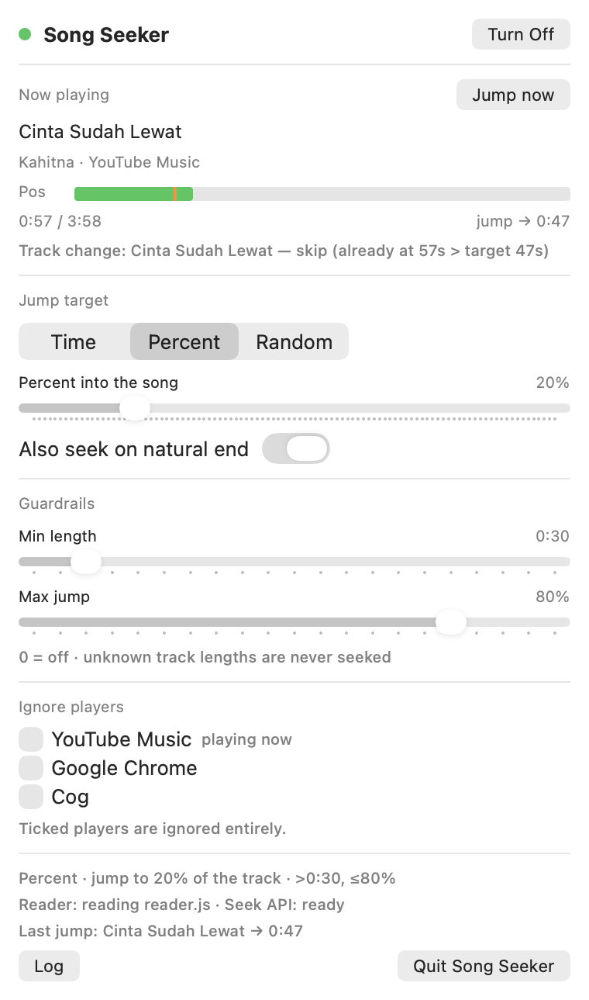

# Song Seeker — macOS 🎛️

Radio vibes for **any** media player on macOS (YouTube Music in Chrome, Safari,
Spotify, Apple Music, Cog, …): when a new song starts, playback jumps to the spot
you choose — a fixed time, a percent of the song, or a random window.

The rules come from the [Android app](../ytm-radio-seek-android) — including its
guardrails; the panel is built the way the sibling [IRSVerb](../irs) app is: a
SwiftUI `MenuBarExtra` window, an `AppModel` behind it, and a small testable kit.
Personal use — it uses private APIs by design.

```
reader.js ──▶ osascript child ──▶ snapshots ──▶ Watcher ──▶ MRMediaRemoteSetElapsedTime
 (JXA)          (Apple-signed)      10 Hz        rules                (private API)
```

## Quick start

```bash
cd ~/ytm-radio-seek-macos
./build.sh                     # builds dist/SongSeeker.app
open dist/SongSeeker.app       # menu bar icon appears; nothing plays differently
```

`./SongSeeker` still works too: `build.sh` keeps that path as a one-line launcher,
so a Login Item (System Settings → General → Login Items) pointing at it starts
the current build.

## The panel



| Control | What it does |
| --- | --- |
| Status dot + **Turn Off / Turn On** | Master switch. Off still tracks track changes, so re-enabling mid-song never yanks the track that is playing |
| **Jump now** | Applies the rule to the song **already playing** — the Android notification's third button. Ignores the dedup and the min-length guardrail (an explicit "do it anyway"), but still refuses a track with no known length. Greyed out, with the reason, while the master switch is off or nothing is playing |
| **Time / Percent / Random** | How the jump target is chosen |
| **Time / Percent into the song** | Fixed offset, or the fraction of every track |
| **From / To** | The window Random picks from |
| **Also seek on natural end** | Off = only seek tracks you skipped to; tracks that ended by themselves are left alone |
| **Min length** | Nothing shorter than this is jumped — an ad, a jingle, or a 26-second X/Threads video in a browser tab. It keys on the *track's length*, not on which app is playing. Android's default is 1:30 |
| **Max jump** | Never jump past this percent, so a long jump can't land you in the outro |
| **Pos** meter | Green = how far in, orange tick = where the next jump lands (a shaded band in Random mode) |
| Status line | The watcher's narration: baseline, track change, `SEEK … → 1:41`, or *why* it skipped |
| Footer | Active rule + guardrails, reader state, seek API state, last jump |
| **Log** / **Quit Song Seeker** | Reveal `~/Library/Logs/SongSeeker/app.log` / quit |

Settings persist in `~/Library/Preferences/com.asep.ytmradioseek.mac.plist`.

## Why a song used to get jumped twice

Two players can hold the now-playing session, and on macOS they hand it back and
forth: YouTube Music plays, a browser tab starts a video, the session moves to
Chrome, the video ends and the session returns to the music. Every hand-back made
the song look like a **brand new track**, and the dedup only remembered the single
most recent jump — which the intervening video had overwritten. The result was a
second, backwards jump in the middle of the song:

```
[09:09:38] SEEK Sinikini - Dan Senyumlah (VC) → 0:57 (dur 286s, was 119s) [YouTube Music]
```

What the watcher does about it:

1. **The ignore list** (the structural fix). A session from a ticked player is
   ignored outright and never becomes the baseline, so when the song's session
   comes back its key is unchanged and no track change — and no jump — is even
   considered. Tick `Google Chrome` and the X/Threads tabs stop existing here.
2. **A position is only evidence if it belongs to the new track.** The old test
   asked whether the timestamp was recent; a returning session reports a real
   position with an old timestamp, so it slipped through. Like Android, the
   watcher compares the position with the one from before the change — a number
   that has not moved is the previous track's and cannot veto the jump. This is
   what refuses the 62-second pull-back above even with no ignore list set.
3. **A same-title re-post right after the baseline is absorbed** — Android's 3 s
   window. The reader's first line for a track can arrive before the artist (or a
   corrected length) does, and the next line looked like a brand-new track: a jump
   a fifth of a second after launch.

Plus **Min length**, which refuses short items in the first place, saying so in
the status line instead of jumping into a 26-second video.

What is deliberately *not* here is a memory of every track ever jumped to. The
only dedup is the original per-track one — the same track is not jumped twice
within 30 seconds (Android's window, from the first version of this app) — so
replaying a song later still gets its jump.

All three shapes are covered by tests: the ignored player
(`testAnIgnoredPlayerNeverDisturbsTheBaseline`), the song that was jumped before
(`testAVideoStealingTheSessionDoesNotJumpTheSongAgain`) and the one that was the
baseline and is now mid-track (`testAReturningBaselineSongIsNotYankedBackwards`).

## How it works

- **Read** (now-playing info): a persistent `osascript` child runs `reader.js`
  (JXA). On macOS 26 the MediaRemote *read* is gated to Apple-signed processes —
  a normal binary gets nil, but osascript works. The child prints a line on every
  MediaRemote change notification plus a 0.1 s fallback poll, so seek latency is
  the player's own publication time, not our poll interval.
- **Seek**: `MRMediaRemoteSetElapsedTime()` via `dlopen` — the same private
  function the system Now Playing widget uses.
- Same rules as the Android app: baseline the track playing at startup (no jump),
  wait for a length before jumping, never land on the very end, per-track dedup,
  auto-next option, guardrails.

## Layout

```
Sources/SongSeekerKit/     settings, seek maths + guardrails, reader, watcher  (no UI)
Sources/SongSeeker/        SongSeekerApp, AppModel, PanelView, Stores, Diagnostics
Tests/SongSeekerKitTests/  47 tests: seek maths, guardrails, ignore list, every watcher decision
Resources/Info.plist       LSUIElement bundle (no Dock icon)
reader.js                  the JXA reader, copied into the bundle by build.sh
```

`swift test` covers the seek maths and guardrails, and the watcher's decisions:
baseline, waiting for duration, transient media gaps, auto-next gating, trusted
vs stale positions, an ignored player, dedup, absorbing a baseline re-post, and
Jump now.

## Command line

```bash
swift test --disable-sandbox                            # run the tests
dist/SongSeeker.app/Contents/MacOS/SongSeeker --check    # self-check, then exit
dist/SongSeeker.app/Contents/MacOS/SongSeeker --render-panel panel.png
dist/SongSeeker.app/Contents/MacOS/SongSeeker --render-panel squeezed.png --height 600
```

`--check` reports the bundle, the reader script it resolved, whether the private
seek symbol is available, the rule and guardrails in force, and one live
now-playing snapshot:

```
Song Seeker self-check
  bundle          : com.asep.songseeker (/Users/asep/ytm-radio-seek-macos/dist/SongSeeker.app)
  reader script   : …/Contents/Resources/reader.js (found)
  MediaRemote seek: available
  settings        : on · Percent · jump to 20% of the track · >1:30, ≤80% · auto-next on
  ignoring        : Google Chrome
  seen players    : YouTube Music, Google Chrome, Cog
  log             : /Users/asep/Library/Logs/SongSeeker/app.log
  now playing     : YouTube Music · Sudah — Ahmad Band (1:30 / 4:31, rate 1.0)
RESULT: PASS — the seek API is reachable and reader.js is producing snapshots.
```

`--render-panel` photographs the panel off-screen with real AppKit controls (no
screen-recording permission needed) — the quickest way to review a layout change
without hunting for the status item. `--height` squeezes it into a shorter window
on purpose: a `MenuBarExtra` window is capped in height, and anything flexible
inside the panel (a `ScrollView`, say) is squeezed to nothing rather than scrolled
when the content does not fit. The off-screen window is never key, so the
switch and slider tracks come out unpainted; `--check` is the place to read their
actual values.

## Energy

The reader pushes ~10 Hz values, so those live in a `NowPlayingStore` that only
the panel's status rows observe; the `MenuBarExtra` scene itself observes only
the rarely-changing `StatusStore` and `AppModel`. IRSVerb measured the opposite
arrangement — fast values published through the object the scene observes — at
~12% of a CPU core while idle with the panel closed. The panel also mirrors the
fast values only while it is on screen (`panelAppeared` / `panelDisappeared`),
and the 1 Hz health timer only touches `hintMessage` when the message changes.

## Caveats (honest)

- Private API (`MediaRemote`) — no App Store, may need a tweak on future macOS
  releases. The read-side quirk (Apple-signed only) is why the JXA child exists;
  if Apple ever opens a public observer API, `JXAReader` can be swapped for it.
- **Menu bar managers hide new items.** Ice (and Bartender) file a newly seen
  status item into their *Hidden* section; drag the ▶ icon into *Visible* in
  their layout editor, or click their hidden-items chevron to reach it.
- Chrome freezes its media-session updates when the tab is heavily backgrounded;
  the helper stays on the last known state and catches the next change when the
  session resumes.
- `build.sh` needs a plain Terminal. SwiftPM wraps manifest compilation in its own
  `sandbox-exec`, which a nested sandbox refuses, so from inside another sandbox
  run `SONGSEEKER_NO_SWIFT_SANDBOX=1 ./build.sh`.

---

# Song Seeker — macOS 🎛️

Radio vibes untuk **semua** pemutar musik di macOS: saat lagu baru mulai,
langsung lompat ke bagian yang kamu pilih (waktu tetap, persen, atau acak).

Tampilannya seperti aplikasi IRSVerb (panel SwiftUI di menu bar), sedangkan
aturannya mengikuti aplikasi Android:

- **Guardrails** — **Min length** (default Android 1:30) melewati klip pendek,
  **Max jump** (default 80%) menjaga lompatan jauh dari outro, dan lagu tanpa
  durasi (live stream, iklan) tidak pernah di-seek. 0 mematikan masing-masing.
- **Jump now** — terapkan aturan ke lagu yang **sedang diputar** (seperti tombol
  di notifikasi Android). Tombolnya mati (dengan alasannya) kalau sakelar utama
  sedang off atau tidak ada yang diputar.
- **Ignore players** — daftar pemutar yang tidak pernah di-seek sama sekali.
  Centang `Google Chrome` supaya video X/Threads di tab browser tidak mengganggu
  lagu yang sedang diputar.

Perbaikan penting: lagu tidak lagi di-seek dua kali. Dulu, saat tab browser
merebut sesi now-playing lalu mengembalikannya, lagu yang sedang berjalan
terlihat seperti lagu baru sehingga di-seek mundur ke tengah lagu. Sekarang
pemutar yang di-ignore tidak dianggap sebagai ganti lagu, dan posisi hanya
dipercaya kalau memang milik lagu baru (dedup lama tetap: 30 detik per lagu).

```bash
./build.sh                 # bikin dist/SongSeeker.app
open dist/SongSeeker.app   # ikon ▶ muncul di menu bar
./SongSeeker               # jalan pintas lama, tetap berfungsi
```

Catatan: pengelola menu bar seperti Ice menaruh ikon baru di bagian *Hidden* —
pindahkan ikon ▶ ke *Visible* di pengatur tata letaknya. Log ada di
`~/Library/Logs/SongSeeker/app.log`, dan `--check` bisa dipakai untuk memastikan
reader, aturan, serta API privatnya siap.
